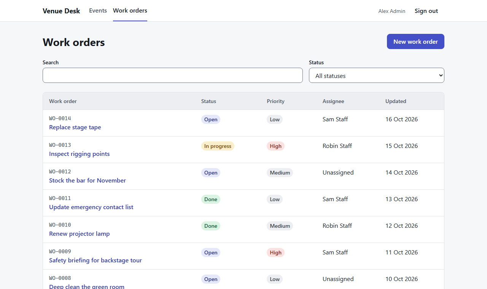
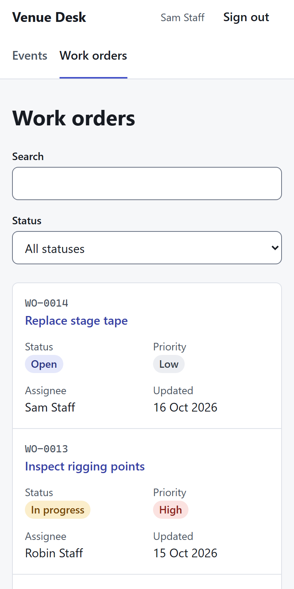
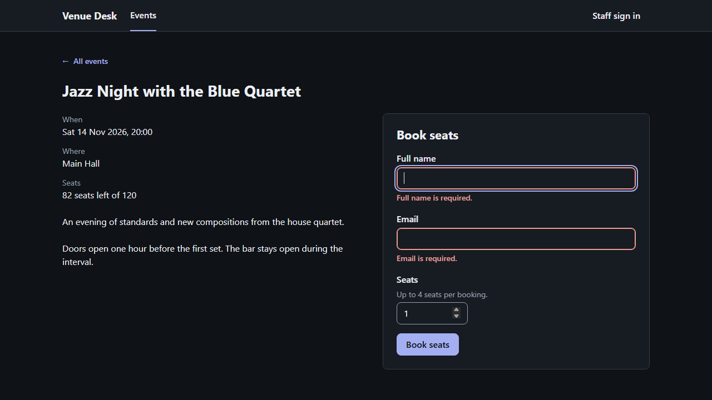

# Venue Desk Web

Angular frontend for Venue Desk, a small product for an events venue: the public books seats, and
staff prepare each event through work orders that follow a status workflow with role-based rules.
It talks to [venue-desk-api](https://github.com/SilverSlytherin1/venue-desk-api) (NestJS, Prisma,
PostgreSQL) over a written contract, and its whole test suite runs without that API.

<p>
  
  
</p>
<p>
  
</p>

## Run it

Requires Node 22.12 or newer.

```bash
git clone https://github.com/SilverSlytherin1/venue-desk-web.git
cd venue-desk-web
npm ci
npm start          # http://localhost:4200
```

The dev server proxies `/api` to `http://localhost:3000` (`proxy.conf.json`), so there is no CORS
setup in development. Start the API from
[its own repository](https://github.com/SilverSlytherin1/venue-desk-api) with `docker compose up`.

Demo accounts from the API seed data:

| Role  | Email                  | Password       |
| ----- | ---------------------- | -------------- |
| Admin | `admin@venuedesk.test` | `demo-admin-1` |
| Staff | `sam@venuedesk.test`   | `demo-staff-1` |
| Staff | `robin@venuedesk.test` | `demo-staff-2` |

### Without the API

```bash
npm run test:ci    # unit tests: Vitest, jsdom, no browser needed
npm run e2e        # starts the dev server, then runs Cypress headless with every API call stubbed
```

Other scripts: `npm run lint`, `npm run format:check`, `npm run build`.

## Where to look first

```
src/app
  core/              what the whole app depends on, no UI
    api/             typed models of the contract, one client per resource, the error model
    auth/            session store, token interceptor, route guards
    a11y/            focus management on navigation
  shared/
    ui/              presentational primitives: badge, alert, pagination, dialog, view states
    forms/           field wrapper, submit behaviour, validation wording
  features/          one folder per area, each lazy loaded
    events/          list, detail with booking form, confirmation
    auth/            login
    work-orders/     list, detail, create
    not-found/       the catch-all page
```

Imports point one way: `features` use `shared` and `core`, and `shared` uses `core`. ESLint
rejects an import in the other direction. Components never touch `HttpClient`: route components
load data through the API clients and hand it to presentational components as inputs.

These files show most of how the app is put together:

1. `core/api/api-problem.ts` and `problem-interceptor.ts`: every HTTP failure becomes one typed
   `ApiProblem`.
2. `core/api/loadable.ts`: the loading, error and ready states of a view as one discriminated union.
3. `features/events/event-detail-page.ts`: the booking flow, with the idempotency key and each
   failure the contract defines.
4. `features/work-orders/work-orders-list-page.ts`: filters that live in the URL.
5. `shared/forms/validated-form.ts` and `form-field.ts`: how forms validate, label and report errors.
6. `features/events/event-detail-page.spec.ts`: what the tests look like.

## Decisions and trade-offs

**State in signal services, no store library.** Almost all state here belongs to the server and to
one screen at a time. A page asks `loadable()` for its data and gets a signal of
`loading | error | ready`; the only cross-page state is the session, in `AuthStore`. The cost is
that nothing is cached between pages, so going back to a list fetches it again. That is the right
default for data other people change. Shared caching or optimistic updates would be the point to
introduce a query layer or a signal store.

**`loadable()` instead of `rxResource`.** Angular's resource API does the same job but is still
marked experimental in v21. The helper is small and every read goes through it: the signals a
request reads are its parameters, and a newer request cancels the one in flight. Writes (booking,
transition, create, sign in) are subscribed in the page that triggers them and end with that page
or with the record it is showing.

**One error model.** The API answers failures with `application/problem+json` and a stable `code`.
A single interceptor parses that into `ApiProblem`, and features switch on `code`, never on a
status or a message. One code is added on the client, `NETWORK_ERROR`, for the case where there is
no response to carry one. Error bodies and stored sessions are validated at runtime because they
decide control flow; successful responses are trusted to match the contract types. Generating
those types from the API's OpenAPI document would close that gap. A validation error for a field
that is on screen is shown on that field, and any other one is spelled out above the form.

**The server owns the rules.** Work order buttons are rendered from `allowedTransitions` and
nothing else, so the client has no copy of the workflow table. Seat limits are checked in the form
for speed, but a sell-out is handled as a normal outcome: the page says how many seats are left
and reloads the event.

**Safe retries, and only where they are safe.** A booking carries an `Idempotency-Key`. The key
belongs to the details that were submitted: sending the same details again replays the key, and
editing them makes a new one. The page offers "Try again" only when the outcome is unknown (no
response, or a server error). A sell-out, a closed event, a rate limit and a reused key each get
their own message and next step.

**A confirmation is not a URL.** The confirmation page renders the booking the API returned,
handed over in the router's navigation state. That state lives in the browser's history entry, so
a reload keeps it, while a typed or shared address has no booking and goes to the event page.

**Token in `sessionStorage`.** The contract authenticates with a bearer token and has no refresh
token, so the token has to be readable by script. `sessionStorage` keeps it for a page reload and
drops it with the tab, and the auth interceptor only attaches it to the API base URL. The weakness
is cross-site scripting: an injected script could read it. An `httpOnly` cookie would remove that
risk and add the need for CSRF protection, and it needs server support that the contract does not
have. Here the exposure is limited by a one hour token, Angular's default escaping and no
third-party scripts. If the browser blocks storage the app still works, and the session ends with
the page.

**Hand-written primitives.** The app needs a badge, an alert, a field wrapper, pagination and a
confirm dialog. Those are small, and the dialog is a native `<dialog>`, so Escape and the return
of focus are the browser's work. A component library would be the right call as soon as something
like a combobox or a date picker is needed: those are too intricate to write by hand.

**Tests exercise behaviour through the DOM.** Unit tests start the real routes, guards and
interceptors and replace only the HTTP backend, then find elements by role and accessible name.
An inaccessible control therefore fails a test. Cypress covers the main journeys in a real browser
with fixtures shaped like the contract, and fails any call that was not stubbed.

**Accessibility is part of the structure.** Focus moves to the page heading on navigation and to
the first invalid field on a failed submit. Errors are tied to their field with `aria-describedby`,
async results are announced through live regions, and the work orders table reflows into cards on
a narrow container without losing its table semantics. Colours are design tokens in two tiers
(`src/styles/_tokens.scss`), and `src/styles/tokens.spec.ts` fails the test run if a text and
background pair drops below AA contrast in either theme.

## Deliberately out of scope

- Internationalisation: copy is inline English and dates use one format in the browser's time zone.
- Server-side rendering and hydration.
- Refresh tokens and silent renewal: when the token expires the user signs in again and returns
  to the page they were on.
- Offline support and optimistic updates.
- A manual theme switch: the theme follows the operating system.
- Contract endpoints with no screen yet: editing a work order, creating events, listing and
  cancelling bookings.

## Notes

- Unit tests use Vitest through the Angular CLI. End to end tests use Cypress.
- `overrides` in `package.json` keeps Vitest on the Vite major that the Angular builder ships.
  Without it, npm 10 fails to resolve Vitest 4.1's optional peer dependencies.

---

Emanuel Pinto, riverdevstudio.it. MIT licensed.
